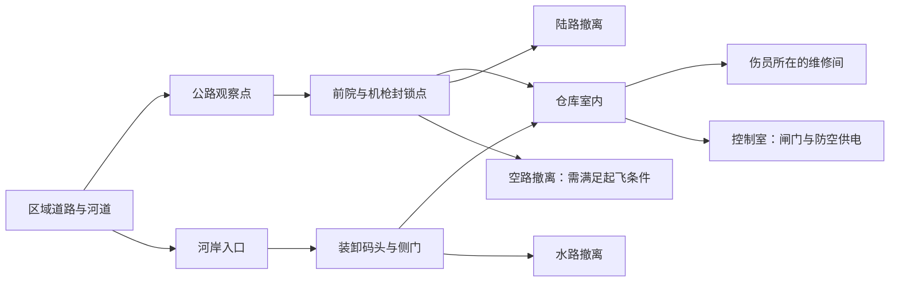

# 第一份武装救援主委托：《封锁线后的两个人》

状态：关卡设计提案；承接《最后一公里》v0.3。此处的时长、人数与配置是原型初值，不是已验证的平衡结果。

视觉执行采用高可读风格化：旧港设施使用蓝灰混凝土、锈红警戒条和大块积水；救援车与伤员使用青绿／暖黄识别色；敌方警戒和弹道使用橙红；地下控制室的“第二信号”使用短暂的青蓝脉冲，不改变第一关的操作目标。

## 1. 任务定位

完成一段短操作教学后进入的第一份正式委托。目标体验：玩家亲自用载具打开入口，下车解决局部战斗和救援，再带着伤员选择一种可行路线撤离。

目标时长约 20—30 分钟，以实际测试调整。三种形态初期均可使用，但本关不强迫三种全部登场。玩家完成后应理解选择形态的理由，而非只按提示换模型。

## 2. 委托内容

委托方：沿海公共救援协调站。

地点：旧港六号转运站及相邻河道。转运站外围的大部分荒地、堤坝和浅滩均可直接驾驶，不要求玩家沿公路抵达；道路只是更快、更安全的选择。

已知情况：武装打捞团伙占据转运站；两名维修人员未能撤离，一名可能无法行走。附近桥梁损坏，水路尚可通行，旧防空设施仍然有电。天气预报显示水位将在行动期间逐步上涨。老车可以绕过桥梁从荒地接近，但越野会消耗更多动力并暴露在封锁点视线内。

主要目标：找到并撤离两名维修人员，将其送往区域诊所。

可选目标：回收一块水闸备用控制器，有助于后续修复公共通路。控制器不与伤员争夺必要的医疗位，但其额外重量会影响老车的飞行能力。

任务前提供：行动预付、建议的医疗与弹药储备、两名人员的最后已知位置、旧道路与码头入口情报。情报注明防空设施现状尚未实地确认。

## 3. 空间关系

维修间与控制室有可读的分岔，不要求反复穿越长走廊。担架转运路线宽于普通步行通道，车能停靠的位置用装卸区、地面标线与破损护栏自然提示。

至少保留一个不经过固定机枪正面的侧翼入口。水位变化改变部分外部路线，不突然淹死所有室内目标。建筑边界是本关最重要的硬边界：车可在建筑外自由寻找停车位置，但必须下车进入室内。

## 4. 任务节奏

| 阶段 | 玩家行动 | 紧张来源 | 提供的喘息 |
|---|---|---|---|
| 观察 | 从公路高处或河岸查看入口与封锁点 | 暴露后可能引起警觉 | 暂不启动伤员恶化计时 |
| 突破 | 车载火力压制正门，或走水路侧翼 | 固定射界、巡逻与车辆受损 | 占领入口后可安全停靠 |
| 下车 | 进入仓库，交战并寻找目标 | 掩体、视线与局部增援 | 控制室或维修间提供短暂安全区 |
| 救援 | 发现两人，简化处置、打开接驳通路 | 搬运限制、医疗资源与外部水位 | 伤情稳定后给规划时间 |
| 撤离 | 选择陆、水或空路，装载目标 | 载重、剩余火力、追踪条件 | 脱离追踪后进入平静交接段 |
| 交接 | 将人员送达诊所 | 无新增突然袭击 | 结算与短对话展示后果 |

外部水位采用可见阶段与广播预警。首关不同时叠加严格天气倒计时、紧急医疗倒计时与无限增援。时间压力由一个主要来源承担。

## 5. 载具战斗与步行战斗

公路封锁点拥有明确射界，正面通过危险，但可以由车辆压制，或从河岸绕到侧门。固定武器的电源／操作位置能被看见，不把弱点藏在毫无线索的装饰中。

仓库步枪手使用可理解的掩体与侧翼。房间较小，战斗距离和遮挡适合固定斜俯视镜头。墙体遮挡通过透明处理与轮廓提示解决，敌人不会从不可见楼层无提示射击。

步行战斗采用已确认的纯实时动作射击。移动和瞄准独立，掩体旁的通行宽度足以快速换位；敌人暴露、瞄准、开火与换弹给出可观察的窗口。第一处步行交战先展示正面掩体与侧面通路，再在后续房间加入第二个射击方向。首次学习担架转运时保证附近安全，之后才让玩家自行创造转移窗口。

救援交互可以中断并保留合理进度。烟雾后转运、先清理通道再搬运都应可行。担架暂置点和车辆接驳点之间避免狭窄折角；不以搬运物碰撞卡住来增加难度。

原型先用少量手工布置的战斗组。扩展版本加入通讯员：玩家可以听见呼叫并看到通讯设备，打断呼叫可阻止一支有限增援；呼叫已经成功时标出可能的抵达方向。没有无限刷新。

救援工具参与战斗：绞盘拉走路障形成侧翼；切割工具打开接驳门；烟雾帮助短距离转运。工具不是每关必须按顺序使用的钥匙。

## 6. 两名受救者

维修员一：可自行移动，熟悉站内设施，指出控制室和侧门位置。交火时可被安排在选定的安全处等待，不会主动跑进敌人射线。

维修员二：需要简化现场处置和担架转运。稳定后可在医疗位中安全运输，避免第一关用复杂伤情直接否定飞行形态。

两人都能装入基础救援配置。任务不会事后宣布基础舱位不足。额外货物与重装配置可能超出飞行载重，整备和装载界面提前展示。

## 7. 三种撤离方案

### 陆路

接驳距离最短，汽车有较好的防护与稳定火力。需要打开前院通路并处理一处路障；伤员可暂留在维修间的安全处，玩家先清理路线。水位上涨后部分低洼捷径失效，但有提前预警的高路可用。

### 水路

需要打开装卸码头闸门，将车移到侧门接人。船能带走两人和可选控制器，适合重载。返程会经过一段暴露河道，需要利用桥墩遮挡或提前解除岸边火力；不要求再清空整个据点。

### 空路

需要在控制室关闭旧防空设施，并从前院可起飞区域出发。两名救援对象与轻装配置可以满足载重；选择重装和额外控制器时，玩家需要卸下非必要货物或放弃该路线。天气首关保留可飞窗口，以载重与防空作为主要条件。

三条路线各有条件，均有完整的可达路径。不能让某件必要开门物品只能从门后取得。原型阶段先实现陆水两路，补齐飞行路线后再认定三栖循环验证完成。

## 8. 失败与长期变化

| 结果 | 当次结算 | 后续变化 |
|---|---|---|
| 两人获救 | 救援报酬与关系改善 | 转运站出现后续维修委托 |
| 只救出一人 | 部分报酬、现场结果记录 | 另一人根据现场状态继续失联、被转移或确认伤亡 |
| 未回收控制器 | 不发放对应回收奖励 | 公共水闸修复需要后续替代行动 |
| 未解除封锁 | 撤离任务仍可能完成 | 该通路维持敌方控制，后续旅行可绕行 |
| 车辆失能、玩家获救 | 拖救代价与可解释的货物损失 | 出现维修、租赁或打捞恢复途径 |
| 有人员确认死亡 | 人物关系与后续对话改变 | 相关联系人由同事或机构接替，不锁死后续主线 |

未带走的受困者不会仅因玩家踏出关卡边界便自动死亡。任务结束时根据伤情、现场安全和敌方活动说明状态；未知信息保留为未知，后续通过广播或调查更新。

本关不为每个组合写完全独立的剧情树。人员、设施、封锁、设备各自记录少量状态，由后续任务读取，保持后果可控。

## 9. 故事片段

出发前，协调站发现玩家仍在使用老式救援呼号：一位接线员认出那是上一位车主的号码，但只说“这条河以前他很熟”。

到达后，旧日志上的码头入口仍然存在，正门路线却已经过时。玩家依据现场情报修改笔记。

在接近转运站地下控制室时，老车会短暂发出不属于机械系统的节律声，扫描界面出现一个无法解释的“第二信号”。它只持续几秒，不改变本关操作，也不立即解释为外星生命；这是后续共生核心剧情的第一处伏笔。

交接后，获救维修员提到另一座失去联系的泵站。若无人获救，线索通过协调站的设施记录提供，内容和关系不同，后续进程仍能继续。

台词每次只承担一件事：提示可操作的信息、表达人物反应或提供下一条线索。

## 10. 验证重点

1. 玩家能否在受伤前理解机枪封锁方向、侧翼入口和车辆停靠位置。
2. 驾驶火力与步行交战是否都发挥作用，而非一套操作能轻易包办全部目标。
3. 玩家是否在找到伤员后主动重新考虑撤离方案。
4. 搬运是否紧张但不笨拙，安全处是否容易识别。
5. 失败后能否说清原因、看到世界变化，并知道下一步如何继续。
6. 飞行路线开放后，陆路与水路是否仍因载重、准备和地形具有选择价值。
7. 实时瞄准、换位和救援交互能否流畅衔接；伤害是否来自玩家能识别和反应的威胁。

